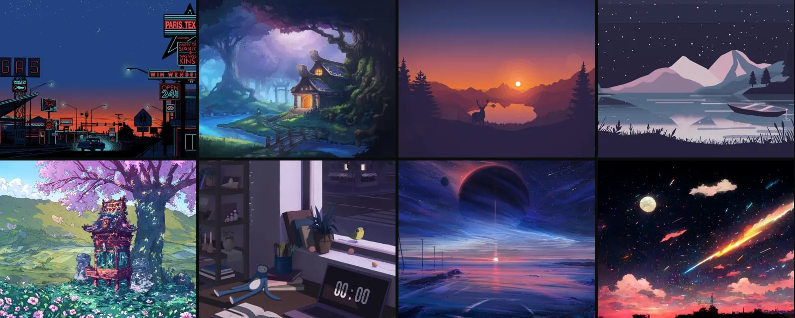

<p align="center">
  <a href="https://alexandrosliaskos.github.io/Awesome_Wallpapers/">
    
  </a>
</p>

<h1 align="center">Awesome Wallpapers</h1>

<p align="center">
  A fast, searchable gallery of aesthetic wallpapers.<br>
  Free to download. No ads, no tracking.
</p>

<p align="center">
  <a href="https://alexandrosliaskos.github.io/Awesome_Wallpapers/"><b>Browse the gallery →</b></a>
</p>

<p align="center">
  <a href="https://github.com/AlexandrosLiaskos/Awesome_Wallpapers/stargazers"></a>
  <a href="https://alexandrosliaskos.github.io/Awesome_Wallpapers/"></a>
  <a href="https://github.com/AlexandrosLiaskos/Awesome_Wallpapers/actions/workflows/deploy.yml"></a>
  <a href="LICENSE"></a>
</p>

## What this is

A gallery for people who care how their desktop looks: Nord, Gruvbox and Catppuccin setups, anime backdrops, pixel art, minimal logos, landscapes worth a second monitor.

The gallery is this repository's work. The wallpapers are not: they were collected by [D3Ext](https://github.com/D3Ext) in [aesthetic-wallpapers](https://github.com/D3Ext/aesthetic-wallpapers) and belong to the artists who made them. [NOTICE.md](NOTICE.md) has the details, including how to have a wallpaper credited or removed.

## Features

- **Search and filters.** Search by name or tag, then narrow by size (FHD to 4K+), shape (desktop, ultrawide, phone) and dominant colour. A filtered view has its own address, so it can be shared.
- **A page for every wallpaper**, with its resolution, aspect ratio, format, file size and a five-colour palette. Click a colour to copy its hex code.
- **A page for every tag**, from [Nord](https://alexandrosliaskos.github.io/Awesome_Wallpapers/tags/nord/) to [pixel art](https://alexandrosliaskos.github.io/Awesome_Wallpapers/tags/pixel-art/).
- **Keyboard friendly.** `/` to search, `←` `→` to move between wallpapers, `Esc` to close.
- **Light.** The gallery shows small thumbnails; an original is fetched only when you download it.
- **Private.** No analytics, no cookies, and nothing loaded from other sites.
- **Works without JavaScript.** Browsing, tag pages and downloads are plain links. Scripts add search, filters and the viewer.

## Get the wallpapers

**From the gallery.** Open a wallpaper and press Download.

**All of them, with git.** A sparse clone fetches only the `images` folder:

```sh
git clone --depth 1 --filter=blob:none --sparse https://github.com/AlexandrosLiaskos/Awesome_Wallpapers.git
cd Awesome_Wallpapers
git sparse-checkout set images
```

**From a script.** The whole catalog is one JSON file, with the title, tags, size, palette and addresses of every wallpaper:

```sh
curl -s https://alexandrosliaskos.github.io/Awesome_Wallpapers/api/wallpapers.json
```

For example, to download one at random (needs `jq`):

```sh
url=$(curl -s https://alexandrosliaskos.github.io/Awesome_Wallpapers/api/wallpapers.json | jq -r '.[].raw' | shuf -n 1)
curl -sLO "$url"
```

## Contributing

New wallpapers are welcome. In short:

1. Add the image to `images/`.
2. Add an entry for it to [`data/wallpapers.yml`](data/wallpapers.yml): a title and two to five tags.
3. Run `npm run validate` and open a pull request.

[CONTRIBUTING.md](CONTRIBUTING.md) has the rules for a wallpaper (size, format, naming) and the list of tags.

## Running the site locally

You need [Node.js](https://nodejs.org/) 24 or newer.

```sh
npm install
npm run dev
```

The first run builds a thumbnail and a preview for every wallpaper, which takes about a minute. Later runs only process what changed.

| Command | What it does |
| --- | --- |
| `npm run dev` | Starts the site at `localhost:4321/Awesome_Wallpapers/` |
| `npm run build` | Builds the site into `dist/` |
| `npm run validate` | Checks `data/` against the files in `images/` |
| `npm test` | Runs the tests |
| `npm run check` | Type-checks the project |

## How it works

```
images/              the original files
data/wallpapers.yml  a title and tags for each file, written by hand
data/tags.yml        the tags that may be used
        │
        ▼
scripts/build-media.ts   measures every image, extracts its colours,
                         and makes thumbnails, previews and share images
        │
        ▼
src/                 an Astro site, rendered to static pages
        │
        ▼
GitHub Pages         built and deployed by GitHub Actions on every push to main
```

Width, height, file size and colours are read from the files themselves, so the data files hold only what a person has to decide.

## Credit and removal requests

If you made one of these wallpapers and would like to be credited, or would like it taken down, [open an issue](https://github.com/AlexandrosLiaskos/Awesome_Wallpapers/issues/new/choose). That is all it takes.

## Licence

The code is released under the [MIT licence](LICENSE). The wallpapers are not covered by it; see [NOTICE.md](NOTICE.md).
